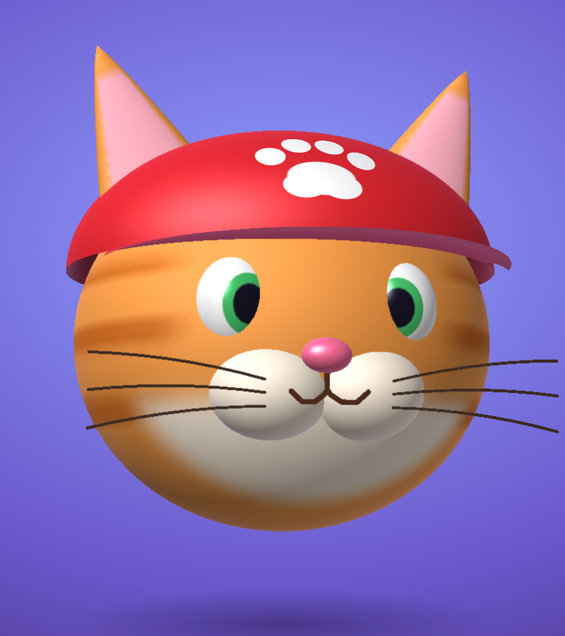

# Meowch!

A stretchy 3D cat face you can grab, pull and share.

**[Play it here](https://gyazbek.github.io/Meowch/)**

If you ever spent more time yanking on a face on an old game's title screen than actually playing the game, you'll get the idea. This is that, except it's a cat. Wearing a cap.

## How to play

- Move your mouse around and the cat keeps an eye on you
- Click and drag to stretch things: cheeks, ears, eyes, nose, whiskers, the cap
- Let go and it stays stretched (after a wobble). Hold Shift while letting go if you want it to snap back instead
- Scroll to spin the head around
- Double-click or press Reset to start over
- Press Share to copy a link to your cat. Anyone who opens it gets the exact same shape you made

Dragging works on touch screens too.

## How it works

- The head, ears, eyes, cheeks, nose and cap are generated from simple shapes when the page loads.
- They're drawn by a small renderer written from scratch. It colours the canvas pixel by pixel, with a depth buffer, lighting and edge smoothing. It doesn't use WebGL.
- Every point sits on a spring and tugs on its neighbours, which is where the rubbery wobble comes from.
- Grabbing a part stretches that part the most and drags the rest of the face along a little.

To run it yourself, download `index.html` and open it in a browser. If you open it straight from your computer, the Share button shows the link in a box to copy by hand, since browsers only allow automatic copying on https sites.

## License

MIT
